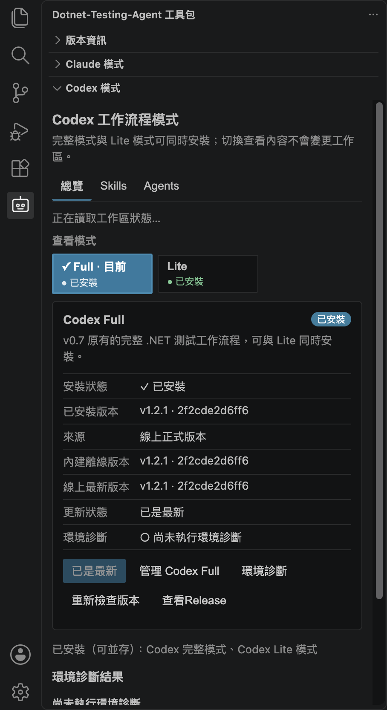
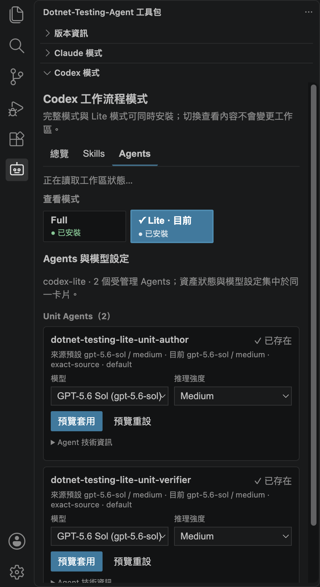
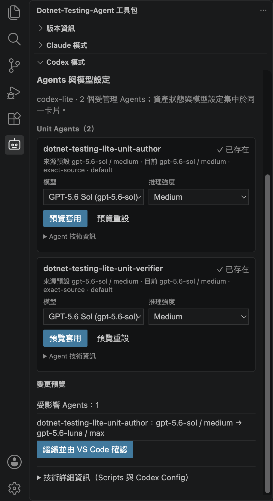

# dotnet Testing Agent v0.8.0

在同一個 VS Code Extension 中安裝與管理 Claude Code、Codex 的 .NET 測試工作流程。

v0.8.0 新增可與完整模式並存的 Claude Lite、Codex Lite，並保留 Claude Full、Codex Full 的 Unit、TUnit、Integration、Aspire 工作流程。側邊欄會分別標示目前查看的模式與各模式是否已安裝；切換查看不會修改工作區。

Codex Full／Lite 的每個受管理 Agent 都可獨立選擇 GPT-5.6 Sol、Terra 或 Luna，以及 Low、Medium、High、XHigh、Max 推理強度。設定會先顯示唯讀預覽，再交由 VS Code 原生確認；Full 與 Lite 的選擇互相隔離。

## Full／Lite 模式

藍色實心按鍵與「✓ 目前」代表目前查看的模式；`● 已安裝`／`○ 尚未安裝` 則是獨立的安裝狀態。切換查看不會修改工作區，也不會改變另一模式的安裝內容。

## Codex Agent 模型設定

每張 Agent 卡片會顯示資產狀態、來源預設、目前 model／effort、兩個下拉選單及單一 Agent 的預覽套用／重設。受管理路徑和 exact source 收合在「Agent 技術資訊」中。

套用流程：

1. 選擇模型與推理強度。
2. 建立唯讀預覽；此時不寫入工作區。
3. 檢查 before／after tuple，再交由 VS Code 原生確認。
4. 套用成功後 Reload Window，並建立新的 Codex task。

內建正式版本：

- Shared Skills `v2.4.2`
- `unit-test-scenarios` `d0050198` exact commit
- Claude Full `v1.5.0`、Claude Lite `v1.0.0`
- Codex Full `v1.2.1`、Codex Lite `v1.0.0`

安裝與更新會固定 stable Release tag 和 exact commit，再以同一來源計畫完成驗證與原子交易。網路不可用時，乾淨工作區仍可使用完整 bundled snapshot。未知的使用者檔案、Claude 既有設定與 Codex 既有設定值都會保留；衝突或無效設定會停止操作，不會被覆寫。

## 使用方式

1. 安裝 `dotnet-testing-agent-0.8.0.vsix`，完整重啟 VS Code。
2. 開啟目標 workspace，從工具包側邊欄展開 Claude 或 Codex。
3. 選擇 Full 或 Lite 並安裝需要的模式；兩者可同時存在。
4. 執行環境診斷。
5. 若修改 Codex Agent 模型設定，套用後 Reload Window，並建立新的 Codex task。

從 v0.7.0 升級時，請先完整重啟 VS Code，再依面板提示對實際使用的 Claude Full、Codex Full 執行更新或重新初始化，完成後執行環境診斷。Extension 會以保守的 v0.7 exact-source reconciliation 核對既有 managed assets；發現使用者修改、缺檔或來源不符時會停止操作，不會採用未驗證的直接覆寫。Lite 不會自動安裝，需要時再個別安裝。

啟動及完成操作後會檢查 Shared Skills 與四個工作流程的最新 stable Release，提供「查看 Release」、「稍後」及「忽略此版本」。Shared Skills 新版只會通知，不會靜默更新工作區。
